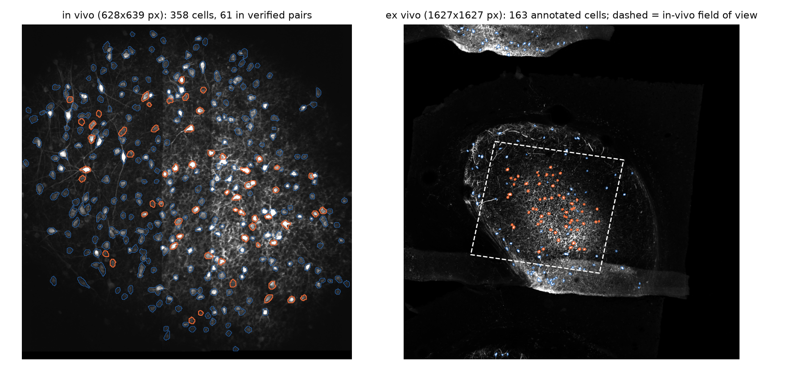
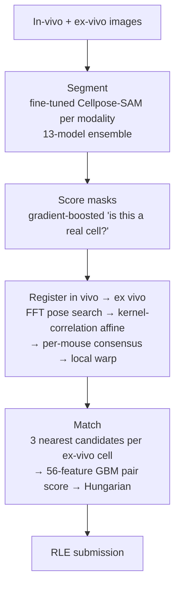
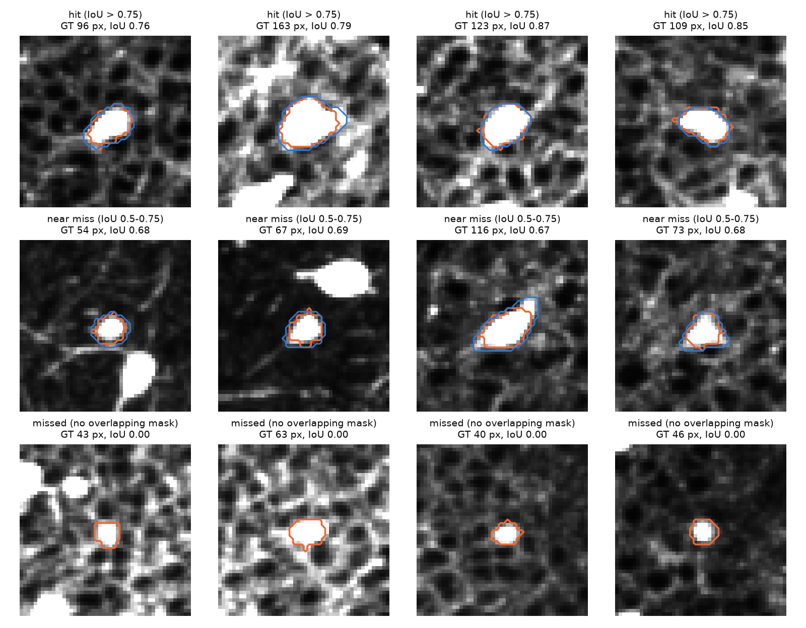
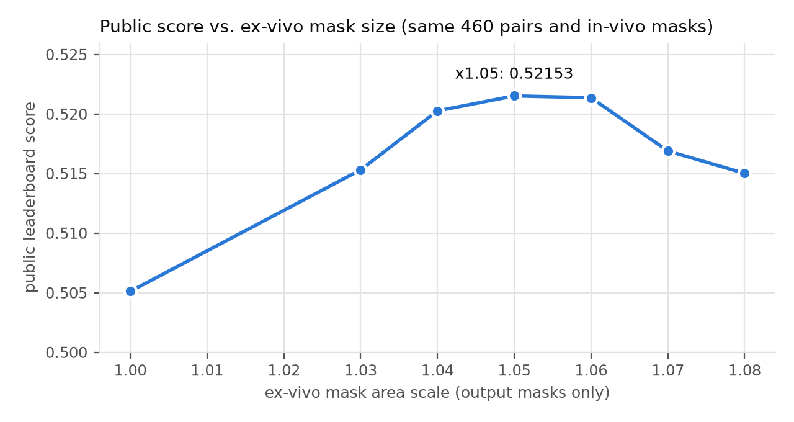

<div align="center">

# 🧠 Cross-Modal Neuron Matching

**Segment every neuron in a living-brain two-photon recording and in a post-mortem confocal scan of the same tissue, then work out which cells are the same neuron.**


-20BEFF?logo=kaggle&logoColor=white)



<sub>One training region. Left: in-vivo two-photon image. Right: the ex-vivo confocal frame, several times larger, with the in-vivo field of view mapped in (dashed). Orange = cells in verified pairs, blue = all other annotated cells.</sub>

</div>

---

## The problem

Neuroscientists record neuron **activity** in a living mouse (in vivo), then remove and process the tissue to read **cell type and gene expression** (ex vivo). Linking the two requires knowing which cell is which across the two images, and they look nothing alike:

- **No alignment is given.** The in-vivo field sits somewhere inside an ex-vivo frame that is several times larger, rotated by up to ~20° and slightly sheared.
- **Ex-vivo images are full of look-alikes:** bright fibres and neuropil reach cell-body intensities.
- **Labels are sparse.** Only 7.6 % of in-vivo cells and 20.6 % of ex-vivo cells belong to a verified pair, so most plausible-looking matches don't count.
- **Every cell needs its own instance mask,** and a match only counts if *both* masks are correct (IoU > 0.75).

**Data:** 47 training regions from 3 mice (14,893 in-vivo cells, 5,516 ex-vivo cells, 1,139 verified pairs). The hidden test set has 29 regions from **2 unseen mice**.

**Scoring:**

$$S = 0.25\cdot \mathrm{PQ}_{\text{in vivo}} + 0.25\cdot \mathrm{PQ}_{\text{ex vivo}} + 0.5\cdot F_1^{\text{match}}$$

PQ is panoptic quality. Matching F1 is pooled over regions, and a pair is correct only if both masks are true positives *and* the pair is verified.

## Results

| | Score |
|---|---:|
| **Kaggle public leaderboard** | **0.52153** |
| Staff baseline | 0.4259 |
| Leave-one-mouse-out CV (pooled, before output calibration) | 0.487 |

<details>
<summary><b>Leave-one-mouse-out breakdown</b></summary>

| Held-out mouse | PQ in vivo | PQ ex vivo | Pair precision | Pair recall | Pair F1 | Score |
|---|---:|---:|---:|---:|---:|---:|
| 5d294c | 0.721 | 0.453 | 0.516 | 0.461 | 0.487 | 0.537 |
| b2ba5e | 0.707 | 0.322 | 0.188 | 0.262 | 0.219 | 0.367 |
| db6b8b | 0.769 | 0.352 | 0.703 | 0.311 | 0.432 | 0.496 |
| **Pooled** | 0.735 | 0.378 | 0.492 | 0.362 | 0.417 | **0.487** |

Validation always holds out a whole mouse, because image appearance *and* annotation style change from mouse to mouse.
</details>

### How the score was built

Each row adds one component to the one above, so this doubles as an ablation on the hidden test mice:

| Step | Public score |
|---|---:|
| U-Net baseline (with an off-by-one RLE bug) | 0.27316 |
| Same model, RLE convention fixed | 0.41885 |
| U-Net v2: better targets + test-time augmentation | 0.45614 |
| Zero-shot Cellpose-SAM (in vivo) + U-Net (ex vivo) | 0.46928 |
| **Fine-tuned Cellpose-SAM** for both modalities (3 fold models) | 0.49072 |
| + all-data model in the ensemble | 0.49847 |
| In-vivo masks from two Cellpose-SAM families | 0.50453 |
| + lower pair threshold (460 pairs) | 0.50512 |
| + ex-vivo masks grown ×1.03 | 0.51532 |
| **+ ex-vivo masks grown ×1.05 (final)** | **0.52153** |

## How it works



**1. Segmentation: fine-tuned Cellpose-SAM.** Cellpose-SAM is a ViT-L network that predicts a flow field pointing to each cell's centre. Zero-shot, it already matched 86–92 % of verified in-vivo cells, but only 12–48 % of ex-vivo cells, so fine-tuning per modality mattered most there. For each held-out mouse, one model trains on the other two, and one more model trains on all three. The test-time masks average the flows of all models: 8 models in family 1, plus 5 in-vivo models from a `cpsam_v2` family at a different input scale. Ex-vivo models train on cell-centred crops, because most of each ex-vivo frame is empty tissue.

**2. Mask scoring.** A histogram gradient-boosting classifier rates every predicted mask from its shape, brightness, contrast and neighbourhood. The score feeds into pair matching.

**3. Registration.** The transform from in vivo to ex vivo is modelled as an affine `x_ex = A·x_iv + t`, estimated from **predicted cell centroids alone**:
- a coarse **FFT cross-correlation** search over rotations (−25°…25°), scales and shears;
- **kernel-correlation refinement** of the best 24 hypotheses, with the Gaussian width annealed from 8 to 2.5 px. This is a soft ICP that tolerates the fact that most cells have no partner;
- a **mouse-level consensus**, since regions of one mouse share almost the same pose;
- image cross-correlation as independent evidence, and a leave-one-out residual field for small local deformations.

**4. Matching.** For each ex-vivo cell, the 3 nearest warped in-vivo cells within 8 px become candidates, each described by 56 features: distances before and after the local warp, rank and gap to the runner-up, local support, mask scores, areas and density. A second gradient-boosting model, trained with the competition's exact correctness rule, scores the candidates. The **Hungarian algorithm** then picks a one-to-one set of pairs that maximises Σ(p − τ).

## What I learned

**Ex-vivo segmentation is the bottleneck, not registration.** Replacing my registration with the ground-truth affine raised the held-out score by only 0.024. Of the 1,139 verified pairs, the ex-vivo mask was right for just 59 %. Most failures are *near misses*: 27.6 % of verified ex-vivo cells land at IoU 0.5–0.75, often one boundary pixel away.

<p align="center">
  
  <br><sub>Ex-vivo cells from a held-out region (orange = ground truth, blue = prediction). Rows: hits, near misses (≈ 1 px off at the boundary), missed cells.</sub>
</p>

**Annotation style shifts between mice, and held-out data can't see it.** The ground-truth boundary sits at a median 20 % of peak intensity for one training mouse, but 38–39 % for the other two. Shrinking ex-vivo masks helped on held-out training mice but always hurt on the test mice. Growing every final ex-vivo mask by 5 % of its area, into its most probable neighbouring pixels, was the largest late gain:

<p align="center">
  
</p>

**What didn't transfer:** longer ex-vivo training, a second ex-vivo model family, and a CNN that redraws paired masks. All three improved held-out scores but lost on the test mice. Model changes transferred; post-hoc edits tuned on the training mice mostly did not.

## Run it

Requirements: an NVIDIA GPU with ≥ 12 GB, ~32 GB RAM and ~25 GB disk. Install PyTorch with CUDA first, then:

```bash
pip install -r requirements.txt
```

The whole pipeline (Windows PowerShell, ~6–7 h, resumable):

```powershell
.\run_all.ps1 -DataRoot "C:\path\to\Project_2_Dataset"
```

Or step by step on any OS (add `--data-root <DATA_ROOT>` to each command):

```bash
python run_pipeline.py --stage prepare  --config configs/final.json
python run_pipeline.py --stage cp_train --config configs/family_ft1.json --modality iv ex --folds 0 1 2 3
python run_pipeline.py --stage cp_train --config configs/family_ft6.json --modality iv --folds 0 1 2 3 4
python run_pipeline.py --stage cp_infer --config configs/family_ft1.json --modality iv ex --folds 0 1 2 3
python run_pipeline.py --stage cp_infer --config configs/family_ft6.json --modality iv --folds 0 1 2 3 4
python run_pipeline.py --stage cp_blend --config configs/final.json --modality iv --tags ft1 ft6 --out-tag ftmix6
python run_pipeline.py --stage submit   --config configs/final.json --out submissions/submission.csv

# optional: leave-one-mouse-out score of the full pipeline
python run_pipeline.py --stage evaluate --config configs/final.json
```

Cellpose downloads its pretrained `cpsam` / `cpsam_v2` weights on first use. Given cached Cellpose outputs, the final stage is deterministic and reproduces `reference_output/submission_final.csv` byte for byte. GPU training itself is not bit-exact. The competition data isn't redistributed here.

## Repository layout

```
run_pipeline.py          CLI entry point (prepare / cp_train / cp_infer / cp_blend / submit / evaluate)
run_all.ps1              end-to-end reproduction
configs/                 model families + final decoding, registration, matching and output settings
q5/
  cellpose_train.py      Cellpose-SAM fine-tuning per modality and fold
  cellpose_seg.py        inference, fold-model flow averaging, mask decoding
  register.py            FFT pose search, kernel-correlation refinement, local warp
  consensus.py           mouse-level pose consensus
  imgreg.py              image cross-correlation evidence
  match.py               instance + pair features, Hungarian assignment
  pipeline.py            mask filter, registration driver, pair classifier, held-out evaluation
  metrics.py             competition metric (PQ at IoU > 0.75, pooled pair F1)
  data.py / prep.py      data reading, RLE codec, caches, subject-level folds
  submit.py / tune.py    CSV writing with strict validation, threshold tuning
reference_output/        the submitted CSV, for comparison with a re-run
```

---

<sub>Built for the Cell Matching × Segmentation Kaggle competition in NYU Tandon's CS-GY 6643 Computer Vision (Fall 2026). Pretrained weights: Cellpose-SAM (Pachitariu, Rariden & Stringer, 2025), built on Segment Anything.</sub>
